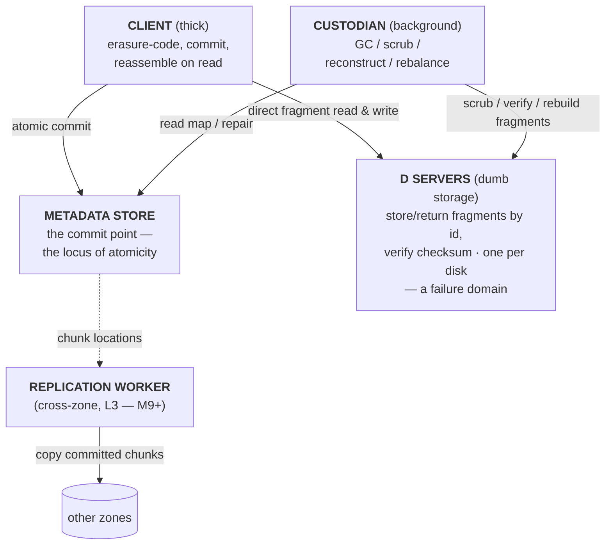

# 5. Building block view

> Living document. The system is described through **two complementary views**:
> the **actor view** (§5.1 — what the moving parts are and how they collaborate
> to perform an operation) and the **layer view** (§5.2 — how those parts map
> onto scope tiers, and why bulk data never crosses a shared component). They
> answer different questions and are both load-bearing: the actor view is how you
> *learn* the system; the layer view is how you understand its *scalability*. See
> `diagrams/c4-container.mermaid` for the container diagram (the actor view) and
> `diagrams/layer-stack.mermaid` for the layer stack.

## Why two views

The actor view and the layer view are two decompositions of the same system, cut
along different axes:

- **The actor view** answers *"what are the components, and how do they
  collaborate to do a write?"* It is the operational and learning frame — the one
  you reach for to explain the system or reason about a request. Its centre is the
  **commit point**.
- **The layer view** answers *"what scope does each part have, and why doesn't
  bulk data bottleneck on a shared component?"* It is the scalability frame — the
  one that justifies the whole architecture. Its decisive property is that the
  globally-scoped tier holds only tiny, high-value truth.

Neither subsumes the other. A component's *identity and collaborators* come from
the actor view; its *scope and the scaling consequences* come from the layer view.
The sections below give each in turn.

---

## 5.1 The actor view — the components and how they collaborate

The system is, at its core, **five components orbiting a single commit point**.
Everything else (gateways, coordination, replication) is in service of these.



The metadata store sits at the centre because the **atomicity guarantee lives in
one mutation there**; the other four components collaborate around it.

| Actor | One-line role | What it is, precisely |
|-------|---------------|-----------------------|
| **Metadata store** *(the commit point)* | Holds the map and hosts the single atomic mutation that makes a write visible. | The linchpin. Inodes, dirents, chunk maps, the pending-chunk ledger, version counters. The atomicity guarantee — the project's reason to exist — lives in *one mutation here*, not in any other component. `redb` embedded (dev) / **FoundationDB** production (ADR-0042), behind `MetadataStore`; TiKV is a retained fallback with development stood down (#443). |
| **Client** *(the thick brain)* | Erasure-codes, writes fragments directly to D servers, issues the atomic commit, reconstructs on read. | Where the intelligence lives. It is the *only* component that understands what a *file* is: chunk → RS(k,m) encode → direct parallel fragment writes → atomic commit; on read, reconstruct from any *k* of *n*. Embedded in every L1 gateway. `client` crate, `reed-solomon-simd`. |
| **D server** *(dumb storage)* | Stores and returns fragments by id, verifies checksums, reports health. | Deliberately stupid: no placement logic, no metadata, no erasure coding, no reconstruction. A disk with a gRPC interface and a checksum check. **One per disk** — each is an independent failure domain (ADR-0034). `dserver` crate, `ChunkStore` trait. |
| **Custodian** *(background health)* | Keeps stored data healthy over time and emits durability telemetry. | Four jobs: **GC** (collect orphaned/failed-write garbage), **scrub** (re-verify checksums to catch bit-rot *before* it's needed), **reconstruct** (rebuild lost fragments when a D server dies), **rebalance** (drain hot/decommissioning servers). Reads and repairs against the metadata store and D servers. Emits the durability plane (ADR-0011). `custodian` crate. |
| **Replication worker** *(cross-zone, L3 — M9+)* | Replicates committed chunks between zones, asynchronously, off the foreground write path. | Copies whole committed chunks to other zones per policy; a remote replica becomes readable only once its catalog record commits. Async by default; sync-N-zone is a per-tenant opt-in. Does not exist at single-zone scale. `proto`/NATS JetStream. |

Holding these together, off the data path: **coordination (L5)** — service
discovery, leader election, locks — where D servers register and the custodian
leader-elects, so the actors can find one another.

### How they collaborate — the write path as actor interaction

The single most important collaboration, and the one that defines the system:

1. The **client** registers chunk ids in the **metadata store**'s pending-chunk
   ledger (leased; the file exists nowhere yet).
2. The **client** erasure-codes the data and writes fragments **directly to the
   D servers** — bulk data flows client→D-server, crossing no shared component.
   The D servers verify checksums. A failure here is harmless, unreferenced
   garbage.
3. The **client** issues *one atomic mutation* to the **metadata store**: write
   the chunk map, set `COMMITTED`, bump the version (conditional on the prior).
   **This is the commit point — the file now exists.** Concurrent writers conflict
   here; exactly one wins.
4. The **client** releases the ledger entries.

Later and asynchronously, the **custodian** scrubs the D servers' fragments
against the map, rebuilds any that are lost (committing the new locations via the
*same* atomic mutation pattern), and emits durability telemetry; the **replication
worker** (multi-zone) copies committed chunks to other zones. Readers never see a
hybrid — only the old version or the new.

The shape to carry away: **dumb storage at the bottom, a thick client and
background custodians holding the intelligence, and a metadata commit point at the
centre as the locus of atomicity — with cross-zone replication off to the side.**
The layer view (§5.2) now shows how these actors map onto scope tiers.

---

## 5.2 The layer view — scope tiers and the scalability property

The system is organized into five layers. L4 and L5 operate within a single zone (one datacenter) and are unaware that other zones exist. L1, L2, and L3 are the layers that span zones. The decisive property throughout: **the layer with global scope (L2) holds only small, slow-changing, high-value truth, so it can afford global consensus without becoming a bottleneck**, while bulk data flows directly between client and storage servers, crossing no shared component.

```
L1  Access layer            S3 / FUSE / WebDAV / SDK gateways      (stateless)
L2  Global control plane     namespace, placement, ACLs, registry   (global consensus)
L3  Cross-zone replication    async chunk copy, global custodians    (off the data path)
L4  Zonal file system         metadata store, D servers, custodians, client library
L5  Bootstrap & coordination  service discovery, leader election, locks, config
```

Where the §5.1 actors live: the **client** is defined in L4 but *embedded in* the
L1 gateways; the **metadata store**, **D servers**, and **custodians** are L4
(zonal); the **replication worker** is L3 (cross-zone); **coordination** is L5.
The actors are unchanged — this view re-cuts them by scope.

---

### L1 — Access layer

Stateless protocol translators. They hold no durable state, scale horizontally, authenticate the caller, and embed the client library (L4) to do the actual storage work. All consistency logic lives below them.

| Component | Technology | Responsibility |
|-----------|------------|----------------|
| S3 gateway | Rust, `gateway-s3` crate | Primary integration surface; object semantics over the file system |
| FUSE / NFS | `fuser` crate; NFS-Ganesha | POSIX-ish access; deliberately second-class |
| WebDAV / Drive | Rust | The consumer Drive surface: sync, sharing links, web UI |
| Native SDK | gRPC + prost | The real interface; streaming reads, atomic commit, append, CAS |

The S3 gateway names no concrete backend. `gateway-s3` is generic over the gateway seam in `gateway-core`, and `wyrd-server`'s `Gateway` implements that seam at the composition root (ADR-0010). The seam is `ObjectGateway` (streaming object PUT, GET and ranged GET, HEAD, DELETE) plus narrow companion traits for what that trait deliberately leaves out (ADR-0046 decision 6): `ContainerGateway` lists a container, and `MultipartGateway` carries the six multipart-upload verbs (create, upload part, complete, abort, list parts, list uploads) in container/object vocabulary. Every multipart answer is a typed value, success or a refusal such as `NoSuchUpload`, and none names an HTTP status; the S3 crate maps them onto the wire. For now `MultipartGateway` answers every verb "not implemented" and the S3 wire still refuses every multipart form with `501`; the verbs are wired to the core multipart paths from #668 on. A PUT carries its **declared object length** across the seam: the S3 crate reads it from the headers (`Content-Length`, or `x-amz-decoded-content-length` for `aws-chunked`; a PUT that declares none is refused `411 MissingContentLength`), and the implementer refuses a length past the single-PUT ceiling, `MAX_MAP_CHUNKS × chunk size` from `wyrd_core::multipart::max_single_put_bytes`, with `GatewayError::EntityTooLarge` (`400 EntityTooLarge`) before it reads the body, then holds the body to the declared length (`GatewayError::LengthMismatch`). The buffered `Gateway::put_object` applies the same ceiling (#671).

**S3 object-key limit (#620).** The S3 gateway holds a key it *creates* to S3's limit of 1,024 bytes of UTF-8. It measures the percent-decoded key alone: not its characters, not its encoded wire form, and not the flat `bucket/key` name it is stored under. The limit is enforced in exactly one place, object `PUT`, where a longer key is refused `400 KeyTooLongError` before any body byte is read and in every payload form alike (a single-shot signed body, an `aws-chunked` stream, `UNSIGNED-PAYLOAD`); a `PUT` whose decoded bucket segment contains `/` is refused `400 InvalidBucketName`, since otherwise `/b%2Fa/k` would store the same object as `/b/a/k` and move part of the key out of the measured segment. No read or delete path checks the limit. Single-object `GET`, `HEAD` and `DELETE` take any key the request line can carry, and bulk `DeleteObjects` has **no per-key bound**: an entry is bounded only by the 8 MiB request-body cap (`MAX_DELETE_BODY_BYTES`, refused whole as `MalformedXML`). That is deliberate. Over-limit objects can already exist — stored before the limit, or written outside the S3 surface by `wyrd put --key` (whose key comes from argv, up to 128 KiB) or the in-process `Gateway::put_object` — and every stored key must stay exactly as deletable as it was. A key past hyper's 65,534-byte request-target ceiling cannot even be named on a request line (single-object `HEAD`/`DELETE` answer `414` before the gateway runs), so bulk delete is its only S3 exit; a length refusal there, whole-request or per-key, would strand it, and a whole-request refusal would also fail every 1,000-key `aws s3 rm --recursive` batch holding one legacy key. The residual: a key too large for the body cap (about 8 MiB of key text; only `Gateway::put_object` can write one) has no S3 exit. That gap predates #620 and is not widened by it; #893 tracks a native key limit below the S3 gateway.

---

### L2 — Global control plane

The brain of the multi-zone system: the one component with a global, authoritative view of what exists and where it should live. It controls by *deciding and recording*; it distributes by *routing actors to the right zones*, never by carrying the payload itself.

| Component | Technology | Responsibility |
|-----------|------------|----------------|
| Global namespace DB | redb (single-zone) / TiDB (multi-region), behind `NamespaceStore` trait (ADR-0020) | Directory tree, file→home-zone mapping, ACLs, sharing, quotas. Globally linearizable, synchronously geo-replicated. |
| Placement service | Rust, policy engine | Decides home zone and replica set per file from policy (residency, replication factor, cost tier, capacity) |
| Zone registry | in the namespace DB | Every zone: region, capacity, utilization, health, capabilities |
| Identity & auth | OIDC for users; internal mTLS PKI for services | Trust fabric (single-provider, so internal PKI not cross-org) |

Holds *metadata about metadata* — kilobytes per file. Consulted on namespace and placement operations (create, rename, share, delete, "where do I read this"), which are rare relative to data operations and ideally cached by clients.

The default L2 backend is the Apache-2.0, CNCF **TiKV** stack — **TiDB** for the SQL surface over it — with **YugabyteDB** or **PostgreSQL** as alternatives behind the `NamespaceStore` trait (ADR-0020). CockroachDB is Spanner-class and works as a backend, but it is **not** a default: it moved to a source-available (non-OSI) licence in 2024, which is at odds with the project's fully-open, sovereignty-friendly substrate goal.

---

### L3 — Cross-zone replication

Turns independent single-datacenter systems into one geographically distributed system, without ever sitting on the foreground write path.

| Component | Technology | Responsibility |
|-----------|------------|----------------|
| Replication workers | Rust; NATS JetStream queue | Copy committed chunks between zones per policy; sync within a region, async across continents |
| Replica catalog | in L2's DB | Tracks which zones hold valid replicas; a replica exists only once its record commits |
| Global custodians | Rust | Disaster recovery: detect zone loss, find under-replicated files, schedule re-replication from survivors |

Default replication is **async** (home-zone commit acknowledges immediately). **Sync N-zone** replication is a per-tenant opt-in that eliminates the data-loss window at the cost of cross-region write latency.

---

### L4 — Zonal file system (the Colossus analog, one per datacenter)

Where atomicity lives and where the bulk of correctness risk concentrates.

| Component | Technology | Responsibility |
|-----------|------------|----------------|
| Metadata store | `redb` (embedded, dev) / **FoundationDB** (prod, ADR-0042), behind `MetadataStore` trait; TiKV retained as a stood-down fallback (#443) | Inodes, dirents, chunk maps, the pending-chunk GC ledger, version counters. Hosts the single atomic mutation that *is* the commit point. |
| D servers | Rust, `dserver` crate; `ChunkStore` trait (local / filesystem / S3) | Store/retrieve EC fragments by chunk ID, verify checksums, report health. Deliberately dumb — no placement logic, no metadata. |
| Custodians | Rust, `custodian` crate | GC (expired pending chunks, orphans), scrubbing (checksum verification → bit-rot detection), reconstruction (rebuild lost fragments from survivors), rebalancing. Emit durability telemetry. |
| Client library | Rust, `client` crate; `reed-solomon-simd` | Chunk → erasure-code → direct parallel fragment writes → atomic commit. Small-file inlining. Append/CAS. Read reconstruction from any *k* of *n* fragments. |

A zone is the unit of atomicity and the unit of (intra-provider) federation.

#### The metadata model

Hierarchical: **inode + dirent**, not path-as-key.

- `inode:<id>` → attributes, chunk map (or inline data for small files), state, version,
  and the **object metadata** the S3 surface serves (ADR-0047): the content digest
  (`etag`, an opaque change-token — the lowercase-hex SHA-256, not MD5), the writing
  client's declared `content_type`, and the content-publication time (`modified`). Each
  is optional with a serde default *and* skipped when absent, so a record written before
  the fields decodes, degrades on the wire to the pre-metadata behaviour, and re-encodes
  byte-identically — the latter load-bearing because every commit is a full-value CAS on
  the record's stored bytes. The store keeps `modified` in epoch milliseconds, and every
  S3 surface reports it at whole seconds: a listing's `<LastModified>` always ends `.000Z`,
  so it names the same instant as the `Last-Modified` header, as S3's own listings do.
- `dirent:<parent_id>/<name>` → child inode id.

Object metadata is stamped only at **content publication** (create / overwrite, in the
same atomic commit as the chunk map). The repair paths — reconstruction, backfill,
rebalance — re-commit the *same* content, so they **preserve** the stored trio: a
placement-maintenance commit never moves `Last-Modified` or drops the content type.
Across overwrites that each record a time, a file's stored `modified` **strictly
increases**: such an overwrite records `max(publishing clock, prior modified + 1 ms)`
(`metadata::overwrite_modified`, which both overwrite commits call; #768), so on an
active/active fleet a gateway whose clock is behind the one that wrote the prior
generation cannot move it backwards while the content moves forwards. There is **no cap
and no automatic correction**: a prior stamped by a badly wrong clock is still ordered
after, and the overwrite logs a warning when the prior is more than a day ahead. The
reason: no data must be lost inadvertently to time drift, and a backwards step can make a
mirror that copies only newer files skip the new content. **An overwrite with no time is
refused** when the version it replaces has one (`metadata::UnstampedOverwrite`, a typed
error; nothing is written), so the stored order cannot reset; over a version with no time
(a legacy record) it is allowed and records none. Both gateway PUT paths always stamp, and
any new path that publishes over a prior generation (the multipart Complete flip, #658)
must stamp and must call the rule, or its overwrites of stamped files fail.

**What S3 shows** is the earlier of the stored time and the serving gateway's clock, in
whole seconds. A response reads that clock once and uses the one value for the
`Last-Modified` header, the listing's `<LastModified>`, the `If-Modified-Since` /
`If-Unmodified-Since` checks and its own `Date`, so the shown time is never later than the
response's `Date` (RFC 9110 §8.8.2.1). An overwrite inside the same second as the time it
replaced can show the **same** one. Which gateway answers can move the shown time by the
clock skew between gateways, which #902's clock sync keeps at milliseconds. A client that
must see every change compares `ETag`, the content-identity token. **A stored time in the
future** (left by a badly wrong clock) is shown as the serving gateway's current time,
which moves forward with each request: until real time passes the stored time, mirrors
re-copy the file on each pass, and `If-Unmodified-Since` with an earlier shown time fails.
A mirror that has only been shown such times misses no change. The exception: a mirror
that already holds a time later than real time, copied while a gateway showed the future
stored time (a gateway without this rule, or one whose own clock was that far ahead), sees
each later overwrite at an earlier time than its copy; if it copies only newer files, it
skips them until an overwrite lands after real time has passed the time it holds. No shown
time can fix that without being later than `Date`, so re-sync such a mirror by `ETag` or
with a full copy. A file with no stored time still shows none. This rule is within
ADR-0047's file-level meaning of `modified` (the file's last-modified time, ADR-0047's
"content-publication time"): the `+1 ms` step and the shown-time cap are implementation
detail below that decision, not a change to it.

The record **types** of the multipart commit protocol (proposal 0016, still a draft) are landed ahead of most of their writers, under disjoint key prefixes: the `mpuctl` admission ledger singleton (a `Budget` profile and the session count it derives `MAX_SESSIONS` from), and per-upload `mpu:<id>` (a session's target, lifecycle state and epoch, and its segment-group nonce — stored in every state from Create to the terminal delete, so the batch that ends a `Completing` attempt can name that attempt's segment records, the nonce at the attempt's fence epoch, and the terminal delete can name the group's reservation marker even for an upload that never reached Complete), `slot:<id>:<k>` (an in-flight part reservation), `part:<id>:<n>` (a committed part's chunk list, length and digest) and `psum:<id>:<n>` (that part's summary), and the reclamation pair `retire:bytes:<token>` (bytes to orphan-mark, then the records that named them) and `retire:records:<token>` (records to delete whose bytes something else still protects), whose value names what one obligation owes — a session's staged residue, a range-encoded set of its part numbers, one part attempt's chunk list, a superseded generation (by the chunk list a flat root carried, or by the segment group a segmented one named — the two shapes a published map has, never both) or a rolled-back completion attempt's segment records, in the combinations the protocol installs as single obligations — every one validated structurally at decode (ADR-0045) rather than trusted on successful JSON parsing alone, so a stored record whose fields disagree with each other (a session whose publish target names another object or another fence epoch, a part whose length is not its chunks' summed length, a slot born already lapsed) is a typed error rather than a live value. A retirement obligation's identity lives partly in its `<token>` — which session at which fence epoch, which part attempt of it, which superseded generation — so its value is decoded **against its own key**, and a payload whose mode, token scope, generation identity or segment epoch disagrees with the token naming it is likewise a typed error rather than an obligation that would reclaim one attempt's bytes while clearing another's. The owned staging entry `sidx:<id>:<n>:<chunk>` is the lease record a streaming write stores under `pending:<chunk>`, plus the owning upload id (`owner`) and the chunk's planned placement (`staged` — an erasure scheme the coder must support, and a D server per planned fragment, a count that decode leaves unchecked as for a committed chunk). Both are present on an owned entry and absent on an ordinary lease, and each is omitted when absent, so a `pending:` record written before them decodes and re-encodes byte-identically — load-bearing because a renewal puts a freshly encoded entry over the bytes it read. A value whose fields disagree with each other or with its key (one field alone, an owned entry under `pending:`, an ordinary lease under `sidx:`, an owner other than the key's) is refused by every reader and both `pending:` writers, and an expiry sweep skips it without reclaiming its chunk; GC's expired-lease input, off unless an operator arms it, also names it on the audit seam, and the post-restore reconciliation holds its chunk unmarked and reports the entry as needing a human, as it does an unreadable chunk map. An ownership field spelled `null` is refused too: the encoder never emits that spelling, so a lease that carried it would be rewritten by its next renewal. Their first production reader and writer is the post-restore session fence (`wyrd custodian --reconcile-after-restore`, `crates/custodian/src/restore.rs`): after its reference passes it re-lists `mpu:` in bounded pages and moves each `Open@E` session to `Aborting@E+1` in one commit with its `retire:` `{session, all}` obligation, so a session resurrected by the restore cannot be completed over reclaimed bytes (proposal 0016 D-B). `CreateMultipartUpload`'s admission writes them too: `wyrd_core::multipart::create::create_session` (#894) writes `mpuctl`, `mpu:` and `seggrp:`, and has no production caller until the S3 verb is wired (#668). It admits a session through `mpuctl` and installs it in one batch: the ledger's compare-and-set on its exact bytes (or, on a store with no ledger yet, the ledger's first value, taken from the caller's profile), the session at `Open`, and its `seggrp:` reservation, each new key under `require_absent`, with the bucket marker required on its exact bytes. So every session it installs is counted in the batch that installs it. A full ledger, a caller whose profile differs from the stored one, a missing or replaced bucket marker, and a session whose record could grow past the value ceiling in a later state are refused, with nothing written. A contention refusal means the create lost or could not settle its commit as many times as the profile in effect admits sessions; each loss is the ledger moving, an outcome the store could not report, or, on TiKV, a lock another writer held with nothing moved, so on TiKV lock contention alone can refuse a create on a ledger with room. A minted identity already in the store is minted again, on a separate budget. A commit with an unknown outcome is re-driven under the same upload id with every precondition read again; a session found under that id afterwards is answered as created only when it is byte for byte the record its batch puts. One that keeps the create's nonce and request but has moved on since its batch landed (a teardown fence, say) is the create's own session, never a collision, and it ends the create in the same error as a batch the create cannot settle: an error that names the upload id and nonce and classifies as indeterminate, so no session it installs goes unreported. `AbortMultipartUpload`'s fence writes them too: `wyrd_core::multipart::abort::abort_session` (#895) moves an `Open@E` session to `Aborting@E+1` and installs its `retire:bytes:` `{session, all}` obligation in the same batch, with the session required on the exact bytes read and the obligation key required absent. The client Abort and the post-restore fence build that batch in one place (`abort::fence_batch`), so the two writers of the `Open → Aborting` edge cannot differ. The fence never moves the admission count: a fenced session still holds its `mpu:` record and its staged bytes, and stays counted until the terminal delete. A `Completing` session is refused `OperationAborted`, and a `Completed` or absent one answers `NoSuchUpload`, with nothing written. Two Aborts racing for one session answer one fenced and one already aborting when the store reports both commits' outcomes; an Abort whose own commit's outcome was unknown cannot tell its fence from a rival's byte-identical one, so it answers fenced too, which is harmless, since the session was fenced once, with one obligation. A lost commit is judged from what the store holds, never inferred: a conflict no re-read explains (on TiKV, a lock another writer held) is retried within a bounded number of rounds, and an obligation key found taken is damage only if the session is still unchanged when read again. An Abort that ends while a fence of it may still land, or before a read could say whether one landed, ends with that unknown outcome: an error that names the upload id and classifies as indeterminate, never one that says nothing was written. It has no production caller until the S3 verb is wired (#668). Nothing else writes or consumes them in production yet — the rest of the protocol (the gateway's fenced state transitions, staged publication, the retirement drain) arrives with the later store round trips (#657–#659) and is specified in the proposal, not here. Because every transition it specifies is a compare-and-set on the record's exact bytes, the decoders enforce serialization identity now, before the protocol's writers exist to depend on it: the accepted set is exactly the encoder's image, byte for byte — an absent `content_type` is spelled only by omitting the field (the inode trio's omitted-when-absent rule), a noncanonical spelling of an accepted value (fields reordered, whitespace inserted) is a decode error rather than bytes a CAS could never match, and a part record's chunk values are read through a closed wire shape of their own, so an unknown or omitted chunk field is a decode error rather than a silent rewrite.

The post-restore reconciliation keeps one more singleton beside them, `mpufence`: the **restore-fence generation** that proposal 0016 requires to complete before any gateway serves multipart verbs on a restored image (0016 names the generation but gives it no key). Its value is `{"generation":N,"complete":B}`, closed and canonical like `mpuctl`'s. `generation` numbers that pass's runs from 1, so the record is absent until the first run, and absent is the only spelling of "no run has happened". `complete` says whether that run finished its session fence. Each run first writes the next generation as not complete, and marks or fences nothing until that write is acknowledged. After its last write it records the generation complete, but only if every write it made was acknowledged and no upload session is left for a human: one it could not read or fence, or a fenced one whose segment records need a human. Every run judges those sessions afresh from their records, so a session an earlier run fenced but could not clear holds back every later run until someone repairs it. Findings that are not about a session, such as a lost or misplaced chunk or an unreadable object or staged record, do not hold the generation back. Both writes are conditioned on the bytes last read there, so a completion that lands late never overwrites a newer run's generation. What the record cannot tell: a restore rewinds it with everything else, so an image captured after an earlier run completed comes back reading complete until the next run starts. No gateway reads it yet. The gateway gate (#508) needs a restore-scoped signal beside it, and until then what keeps multipart off a restored image is the runbook's order: the reconciliation runs with writers stopped, before any gateway is re-enabled.

The protocol's client-visible answers, and the two digests a completed upload is identified by, are landed the same way: as pure functions that no production path calls yet. A multipart object's ETag is composed on ADR-0047's SHA-256 basis, never MD5: the lowercase-hex SHA-256 of the named parts' raw 32-byte digests concatenated in part-number order, then `-` and the number of parts named (`<hex>-<N>`, with `N` from 1 to 999,999, the most parts the `part:` key grammar can address). A `Completed` session record's `etag` holds that ETag whole, suffix included, and decode refuses any other spelling (a bare digest, a count out of range, a noncanonical number), because by the time the session's tombstone answers a retry, the part records the ETag was composed from may already be retired. Beside it, `complete_fingerprint` is a SHA-256 over each named part's number (4 bytes, big-endian) followed by its digest, so the tombstone answers an identical retry with the recorded ETag and a different part list under the consumed upload id with `NoSuchUpload`. Both digests are computed only over a non-empty list in strictly ascending part-number order; any other list is refused, never sorted. Proposal 0016's decision-3 table answers its five verbs (`UploadPart`, `CompleteMultipartUpload`, `AbortMultipartUpload`, `ListParts`, `ListMultipartUploads`) in each session state and for an absent record, in a typed outcome vocabulary that names no HTTP status; the S3 status and XML mapping arrives with #508.

This makes rename a single dirent mutation (atomic under the same mechanism as a write) instead of a mass key rewrite, and makes cross-zone sharing expressible (a dirent pointing at an inode owned elsewhere). It is the strongest concrete driver of the requirement that the metadata store offer an **atomic multi-key transaction**, because file creation must atomically write both the inode and its dirent. That requirement is what disqualified HBase-class stores and what every backend choice since has had to satisfy; the backend satisfying it in production is now FoundationDB (ADR-0042, superseding ADR-0008's TiKV). See section 6.

The store's **read surface is two operations**, and the split is a durability requirement rather than an optimization. `scan(prefix)` returns a whole namespace as one consistent cut and **fails loud** past its per-listing cap instead of truncating — a silently short `inode:` listing would shrink GC's never-reclaim safety set, which is data loss (#262, ADR-0011). `scan_page(prefix, after, limit)` walks a namespace **larger than that cap**, in cursor-keyed pages ordered by raw byte-lexicographic key, with an exclusive cursor and a continuation that may not skip a key present throughout the walk (#634). The second exists because two multipart-era populations outgrow the cap — the deliberately unbounded retirement drain, and GC's orphan ledger, where one maximum segmented-object retirement installs ~1.78 M marks against a cap of 1,048,576 — and a namespace that cannot be enumerated cannot be reclaimed. Both contracts are normative for *every* backend and asserted on all of them by the shared conformance suite (`crates/metadata-conformance`), which is what keeps redb, FoundationDB and TiKV from disagreeing about how a listing behaves.

#### The write protocol (the commit point)

The same collaboration described in §5.1 as actor interaction, here in terms of
the L4 mechanics it touches:

1. **Intent** — client registers chunk IDs in the pending-chunk ledger with a lease. The chunks exist nowhere in the namespace.
2. **Data path** — client erasure-codes and writes fragments directly to D servers, which verify checksums. Failures here are harmless garbage.
3. **Commit** — one atomic metadata mutation writes the chunk map + sets state `COMMITTED` + bumps the version, conditional on the prior version. **This is the atomicity.** Concurrent writers conflict here; exactly one wins.
4. **Release** — delete the ledger entries. Crash between 3 and 4 leaves the ledger to a custodian sweep; crash before 3 leaves leased garbage for GC.

Readers never consult the ledger; they see the old version or the new one, never a hybrid.

---

### L5 — Bootstrap and coordination

The smallest layer by data volume and the one everything else depends on. It answers the questions a distributed system must answer before it can do any real work. Stores kilobytes; never on the data path.

| Component | Technology | Responsibility |
|-----------|------------|----------------|
| Coordination service | etcd (prod) / in-memory (dev), behind `Coordination` trait | Service discovery (leased registration), leader election (single active custodian), distributed locks with fencing tokens, zone-wide config with change notification |
| Deployment substrate | systemd / docker-compose / Kubernetes operator | Process lifecycle. Pluggable; the binary never couples to orchestrator APIs (ADR-0010). |

The Colossus-style bootstrap recursion bottoms out here: etcd depends on nothing above it. Losing L5 loses no data; established connections keep working from cached state. What is lost is the ability to *react* — failovers, elections, topology changes — until coordination returns.

**openraft** is reserved as a future embedded coordination backend (a no-external-dependency production mode) behind the same trait, validated by the existing DST harness once the trait semantics are pinned by two implementations. Not built for v1 (ADR-0006).

---

## 5.3 Cross-cutting components

| Concern | Technology | Crate / location |
|---------|------------|------------------|
| Wire contracts | protobuf + prost | `proto` |
| On-disk format | versioned, spec-first | `chunk-format` + `specs/chunk-format/` |
| Pluggability seams | trait definitions, no impls | `traits` (`ChunkStore`, `MetadataStore`, `NamespaceStore`, `Coordination`) |
| Telemetry | OpenTelemetry (OTLP) | `telemetry` (ADR-0012) |
| Simulation testing | madsim / turmoil | `testkit` (ADR-0009) |
| Composition / the binary | wires all concretes | `server` |
| Blackbox validation | separate `wyrd-validate` binary, no `wyrd-*` dependency | `validate` (proposal 0017) |

The dependency rule (ADR-0010): implementations and consumers depend on `traits`, never on each other's concretes. Only `server` knows the concrete backends, which is what makes "swap redb for FoundationDB" or "in-memory for etcd" a composition change rather than a refactor. The seam earned its keep in M4: swapping the production backend from TiKV to FoundationDB (ADR-0042) touched the `server` wiring and added a crate, and changed no consumer.

`validate` sits outside that rule on purpose: it is a client of a running deployment, not a part of one, and depends on no `wyrd-*` crate (proposal 0017 §9). Its command-line surface is ten required flags — `--endpoint`, `--region`, `--bucket`, `--scenario`, `--duration`, `--workers`, `--seed`, `--out`, `--run-id`, `--driver-placement` — with S3 credentials taken from `AWS_ACCESS_KEY_ID`/`AWS_SECRET_ACCESS_KEY`, else `WYRD_S3_ACCESS_KEY`/`WYRD_S3_SECRET_KEY`, else refused; half a pair, or a variable whose value is not UTF-8, is refused by name rather than skipped over to the next pair (an empty variable counts as unset). Parsing is strict, unlike `wyrd`'s: an unknown flag, a repeated flag, an empty value, a stray positional, or a `--`-prefixed token in a value slot is refused by name rather than absorbed. Three optional flags carry the deployment's tuning, each a positive integer byte count parsed as strictly as the rest: `--chunk-size` (default 1,048,576, the server's chunk size today), `--max-root-value-bytes` (default 50,000, the root value budget today), and `--segment-threshold-bytes` (when absent, derived as ⌊root budget / 315⌋ × chunk size, the largest object whose chunk map still fits one value: 158 MiB at the defaults). A tuning no deployment can have is refused by flag name, never clamped: a chunk size outside the 1 MiB to 16 MiB range the server's `s3` role accepts, a root budget of zero or above 50,000 (half the 100,000-byte value limit every backend inherits from FoundationDB; a bigger budget needs that limit raised), a given threshold below one chunk or not a whole number of chunks, a budget too small to hold one chunk record when the threshold is derived from it (with the threshold given, any budget from 1 to the cap is accepted), or a size the table needs that does not fit in 64 bits. The echo prints each value with where it came from, `(given)`, `(default)` or `(derived)`, and the size classes a run writes are computed from these values, not copied from today's constants: fixed sizes at 0 B, 1 B, 4 KiB and 64 KiB (below any accepted chunk size), at S3's and its SDKs' limits (5 MiB, 8 MiB, 5 GiB, 5 GiB + 1), and at 10 GiB + 1 for the > 10 GiB requirement; and sizes that move with the tuning on both sides of the chunk size `C` and the segmentation threshold `T`, plus 64 × `C`. With the budget capped at 50,000 and the chunk size at most 16 MiB, a derived threshold is at most 158 × 16 MiB (under 2.5 GiB), so at any accepted tuning with a derived threshold the table runs from 0 B to 10 GiB + 1; only a given `--segment-threshold-bytes` above 10 GiB moves the `T` classes past that. A test compares the defaults with what they mirror: the root budget and the 315-byte chunk-record width with the `wyrd-core` constants, the chunk size with the single-PUT limit a default in-process server gateway refuses with, and the chunk-size range with the bounds the server's `s3` role names when it refuses a chunk size. Object bodies are never stored: each is derived from the seed, the key, the size and the write's generation (SHA-256 in counter mode, so any byte range is computed on its own), so a run can re-derive what it wrote, and an overwrite at the same size sends different bytes except at the smallest sizes. Two `n`-byte bodies match with probability 2^(-8n), negligible from a few bytes up but not below: at 0 B every generation is the same empty body, and at 1 B two generations match one time in 256. At those sizes neither the bytes nor the `ETag` (which the gateway derives from the body) can tell a stale read from a current one, which the oracle (#746) has to account for (`crates/validate/src/payload.rs`). The library carries the S3 client every scenario calls through (#852): `aws-sdk-s3` on the `--endpoint`, path-style, with static SigV4 credentials, plain HTTP (TLS is terminated in front of the gateway), and retries and stalled-stream protection off. Its HTTP connector is its own (#853): hyper's HTTP/1.1 client connection, one fresh connection per request and none pooled, which the client takes back from hyper once a response's body has ended, to see what the endpoint sent past that end. Its error is typed: HTTP status, `<Code>`, `<Message>`, and the `x-amz-request-id` read from that header itself. Every response is read strictly, so one that is not a whole, well-formed, correctly framed S3 response is never reported as a clean S3 error, a success, or a shorter object (#853). The client reads an error body itself rather than through the SDK: an empty body is reported as "no body" (never the `NotFound` the SDK makes up for a bodiless 404), an `<Error>` without a `<Code>`, or with an empty one, as "no code in body", and anything but one whole `<Error>` document, nested at most 16 elements deep (the XML parser recurses per level, and an S3 error document is two deep), whose `<Code>` and `<Message>` hold only text, with nothing but whitespace and comments around it, as unreadable. Framing that cannot mark where a body ends is refused on every operation: `Transfer-Encoding` together with `Content-Length`, a transfer coding other than exactly `chunked`, a `204` that frames a body, or a `Transfer-Encoding` on a `304` to a PUT or a DELETE. So is anything the endpoint sends after the end the framing marks (a body longer than its `Content-Length`, a second document after the first, bytes after a chunked body's terminal chunk and trailer section or after a bodiless response): unreadable, or on a GET object a body error, if it has reached the client by the time the body's end is read. A PUT or DELETE success that carries a body, which S3 never sends, is unreadable, unless it arrived early enough to be `AcknowledgedEarly`. A success the SDK cannot read is unreadable, with the SDK's diagnostic kept. Every body the SDK buffers whole (every error response, and every PUT or DELETE response) is capped as it arrives, an error response's body at a fixed 64 KiB budget and a PUT or DELETE success's at nothing, so a body with no declared length is cut off at the budget rather than read whole; S3 error documents stay far below it (the largest, `SignatureDoesNotMatch`, about 20 KiB for this client's requests). A successful GET is outside the budget: its body streams, and is accepted with a correct `Content-Length` or with complete chunked framing, while a close-delimited body or chunked framing cut short is a body error. Connect, operation, body-idle, and whole-body deadlines bound every wait (the last so a peer that trickles a GET body inside every idle window still cannot hold a worker past it), and object bodies stream both ways, so what the client holds of an object does not grow with its size. A PUT reports a receipt only if the caller's source had ended, that is, had given its whole declared length and then reported its end, by the time the response head was read off the socket; a success that arrives sooner is the typed body error `AcknowledgedEarly`, carrying that response's request id, and from that moment the source is not polled again (#854). The client cannot see what the server read, nor an answer its own kernel has received but the HTTP stack has not yet read, so a receipt says only what the client handed over before it read the answer. No PUT outlives its call: each runs on a runtime and a thread of its own, and that runtime is shut down, dropping the source and closing the connection, before the outcome is returned (or promptly after, if the caller drops the call). The price is one thread per PUT and, for every request, one fresh TCP connection, which the client closes, so each request leaves a client socket in `TIME_WAIT`. That caps sustained requests (PUT, GET and DELETE requests together) between one client address and one gateway address at about the number of ephemeral ports divided by the `TIME_WAIT` time, about 470 a second with Linux's defaults (28,232 ports, 60 s); past that, `connect` fails and the client reports `NoResponse`, which the failure taxonomy (proposal 0017 §7) would count against the server as `availability`. The cap is a host default, not a hard ceiling: it holds per pair of client address and gateway address, shared by every worker on that client, and an operator raises it with more client or gateway addresses, a wider `net.ipv4.ip_local_port_range`, or `net.ipv4.tcp_tw_reuse = 1` (Linux's default, `2`, reuses ports on loopback only). Beyond the AWS SDK, `validate` ships only third-party crates from the workspace's audited set (`roxmltree` reads S3 error documents; `hyper` and `hyper-util`, which the SDK's own connector is built on, carry the client's connector); Wyrd crates appear only as dev-dependencies, for the in-process gateway its tests run against. The binary still echoes its resolved configuration (the access-key id, never the secret) and exits without issuing a request; scenarios arrive with #743.
